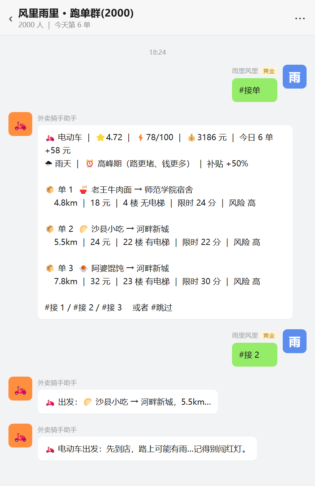
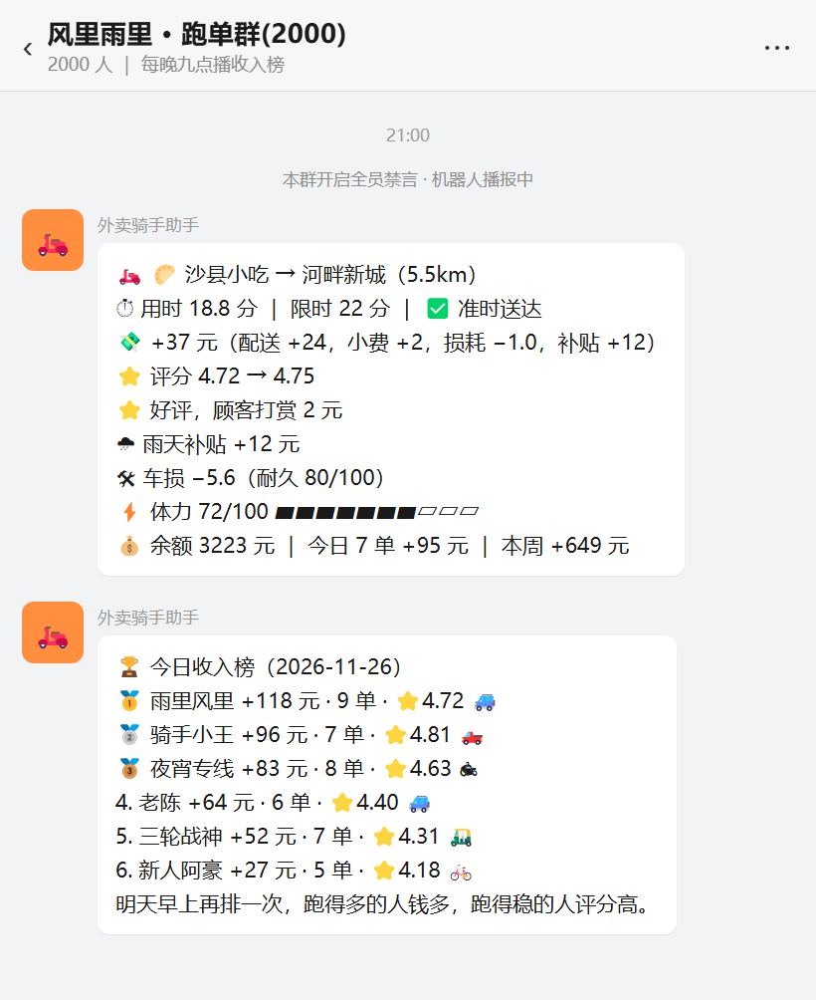

# 🛵 风里雨里 · 外卖骑手

> 一个在 QQ 群里跑外卖的文字游戏插件（AstrBot）。
> 发 `#接单` 派三张单，挑一张跑；超时扣钱、差评扣钱，攒钱换车换装备。晚上九点，群里自动播今天的收入榜。

<p>
  
  
  
  
</p>

这是一个**认真算过账**的群小游戏：不是让 AI 随便编两句话，而是先有一套自己的经济模型——距离、楼层、电梯、天气、车况、体力、评分、段位，每一项都真的进公式。AI 只负责把这一单写成一段有意思的剧情，不碰数值，超时了也不会替你变出钱来。

| | |
|---|---|
| 车辆 | 10 台，从共享单车到性能车，越贵单越远越肥，也越吃油、越容易被交警盯上 |
| 装备 | 10 件，永久生效：坐垫、头盔、雨衣、保温箱、折叠推车、修车会员卡…… |
| 段位 | 6 级（青铜 → 王者），按周收入晋升，只升不降，每级都有实际特权 |
| 天气 | 晴 / 雨 / 雪，全群同一天气，雨雪补贴更高但更容易超时 |
| 榜单 | 每晚 21:00 自动播当日收入榜，前三名有奖牌 |
| 限量单 | 每天 3 张全群抢，30–60 元，手快有手慢无 |

<p align="center">
  
  
</p>

<p align="center"><sub>示意图：卡片上的文字、数字、emoji 全部由插件自己的渲染函数输出（<code>core/render.py</code>），这里只是外面套了一层群聊窗框。</sub></p>

---

## 三十秒上手

在群里直接发：

```text
#接单          → 派 3 张单给你挑
#接 2          → 接第 2 张（#接二、#接两 也认）
#跳过          → 这批不合适，等下一批（扣 2 点体力）
#我的          → 余额、评分、体力、车况、段位、装备
#商店          → 买车买装备，#买 编号 下单
#签到          → 每天一次，连签越久给得越多
#修车          → 什么车况都能修，越烂越贵
#收入榜        → 今天的群内排名
```

> 指令以 `#` 开头，`/`、`＃` 也认。如果你的 AstrBot 配了唤醒前缀或要求 @ 机器人，按你自己的设置来。

发完立刻回一张卡，卡上会 @ 你。

### 派单卡长这样

```text
单 1  益丰大药房 → 科创园 B 栋
      一盒布洛芬缓释胶囊
      备注：到楼下打电话我下去拿
      4.7km ｜ 17 元 ｜ 13 楼 有电梯 ｜ 限时 19 分 ｜ 风险 低

单 2  宠物家 → 科创园 B 栋
      一袋两公斤装猫粮
      备注：送到小区门口等我两分钟
      1.2km ｜ 9 元 ｜ 2 楼 无电梯 ｜ 限时 11 分 ｜ 风险 低

单 3  万师傅五金 → 城南医院
      一盒自攻螺丝和一管玻璃胶
      备注：放丰巢第二格，手机尾号六八
      6.8km ｜ 24 元 ｜ 8 楼 无电梯 ｜ 限时 38 分 ｜ 风险 中
```

每一行都影响结果：距离决定路上耗时和单价，楼层和电梯决定爬楼时间，限时是系统死线，风险是这单跑砸的把握（低 / 中 / 高 / 极高，具体概率不公开，自己掂量）。挑单的门道在于：远单钱多但更险，无电梯高层看着近其实很磨，天气越差越要留余量。

### 结算卡长这样

```text
蜜雪冰城 → 青年公寓（3.2km） · 王女士
两杯杨枝甘露，少冰
用时 19.4 分 ｜ 限时 22 分 ｜ 准时送达
+21 元（配送 +19，小费 +3，损耗 −1）
评分 4.52 → 4.53
商家：提前打包好放在柜台上了
路上：一路绿灯，车少得很
王女士：「这么快？谢谢你啊」
车损 −2.7（耐久 82/100）
体力 88/100
余额 143 元
```

商家 / 路上 / 顾客这三行是这一单的剧情，纯叙事，不影响任何数值。真正决定你赚多少的是上面那几行。

---

## 安装

### 方式一：AstrBot 插件市场（推荐）

AstrBot WebUI → 插件 → 插件市场 → 搜索 **风里雨里** 或 **外卖骑手** → 安装。

### 方式二：手动

```bash
cd <AstrBot 数据目录>/plugins
git clone https://github.com/lyw6263/astrbot_plugin_dafeiyu_waimai.git
```

然后在 WebUI → 插件 → 重载插件（或重启 AstrBot）。

也可以直接下载 [Releases](https://github.com/lyw6263/astrbot_plugin_dafeiyu_waimai/releases) 里的 zip，解压到 `plugins/` 下，目录名保持 `astrbot_plugin_dafeiyu_waimai`。

### 依赖

- **AstrBot** `>= 4.0`
- **Python** `3.10+`（用到了 `X | None` 和 `from __future__ import annotations`）
- 额外依赖见 [`requirements.txt`](requirements.txt)：`apscheduler`（定时榜单）、`aiosqlite`（存档）

```bash
pip install -r requirements.txt
```

### 平台

主要面向 `aiocqhttp`（QQ / NapCat / Lagrange）。指令全部是纯文本，不依赖图片渲染，所以其他适配器只要支持群聊和 @，理论上也能跑。

### 先配好模型（可选）

如果想让每单剧情由 AI 现场写，需要在 AstrBot 里配好一个默认对话模型（WebUI → 服务提供商）。插件不自己存 Key，直接用当前会话绑定的 provider。

模型没配、超时、返回格式不对，插件会自动退回内置素材池，**游戏照常结算，不会卡住**——只是剧情没那么新鲜。

---

## 配置

在 WebUI 的插件配置页里改，字段定义见 [`_conf_schema.json`](_conf_schema.json)。

| 配置项 | 类型 | 默认 | 说明 |
|---|---|---|---|
| `enabled` | bool | `true` | 总开关。关掉后 `#接单` 等指令不再响应，存档还在 |
| `groups_only` | bool | `false` | 只允许群里玩。打开后私聊发指令不响应（排行榜本来就按群分开） |
| `broadcast_time` | string | `21:00` | 每天几点播今日收入榜，`HH:MM`，用服务器本地时间；播过的群当天不重复播 |
| `night_broadcast` | bool | `true` | 关掉后不主动刷屏，只在有人发 `#收入榜` 时才算 |
| `live_ai` | bool | `true` | 每单现编剧情。关掉只用素材池里的句子，零延迟 |
| `live_timeout` | int | `10` | 现编等多久算超时（秒），超时用素材池兜底，建议不超过 12 |

---

## 指令总表

| 指令 | 作用 |
|---|---|
| `#接单` | 派 3 张单（手上还有没挑的单时会提醒） |
| `#接 1` / `#接 2` / `#接 3` | 接第 N 张 |
| `#跳过` | 这批单不要了，扣 2 点体力，等下一批 |
| `#我的` | 车、评分、体力、余额、车况、段位、装备 |
| `#收入榜` | 今天的群内排名 |
| `#抢单` / `#抢 N` | 限量单，全群先到先得 |
| `#商店` / `#商店 装备` | 买车页 / 装备页（20 项一次列不完，分两页发） |
| `#买 N` | 买第 N 项（车 1–10、装备 11–20，编号两页通用） |
| `#吃饭` | 15 元换 40 体力，每天 3 次 |
| `#修车` | 什么车况都能修，按缺多少收钱，越烂越贵 |
| `#签到` | 每天一次，连签越久钱越多，还回体力 |
| `#抄近道` | 白银以上每天 1 次，下一单格外顺 |
| `#帮助` | 群里看这份说明的精简版 |
| `#叙事池` | 看 AI 素材池补到多少条（排障用） |

---

## 玩法

### 十台车

车是这游戏的主线。**车越贵，能接的单越远越贵**，但也更吃油、更容易被堵、被交警盯上。换车之后，手上按旧车速算的那批单会作废——别刚派完单就换车。

| # | 车 | 车价 | 速度 | 最远 | 每单油钱 | 每公里磨损 | 单价系数 | 脾气 |
|---|---|---|---|---|---|---|---|---|
| 1 | 共享单车 | 0 | 12 km/h | 5 km | 0.5 元 | 1.25 | ×1.00 | 起步免费，慢；会扎胎 |
| 2 | 电动滑板车 | 350 | 20 km/h | 4 km | 0.3 元 | 1.40 | ×1.00 | 只敢跑 4km；轮子细、磨得凶；会扎胎 |
| 3 | 电动三轮车 | 700 | 16 km/h | 6.5 km | 0.6 元 | 1.00 | ×1.00 | 能拉大件（+8 元）；车斗晃，2% 侧翻；会扎胎 |
| 4 | 电动车 | 1200 | 22 km/h | 9 km | 1.0 元 | 0.85 | ×1.00 | 均衡，多数人的第一台车；会扎胎 |
| 5 | 老头乐 | 2000 | 30 km/h | 10.5 km | 1.4 元 | 0.75 | ×1.16 | 有棚不淋雨；四轮堵车；没牌照怕交警 |
| 6 | 摩托车 | 3000 | 35 km/h | 12 km | 1.0 元 | 0.95 | ×1.10 | 快、能钻缝；怕交警；会摔车；会扎胎 |
| 7 | 电动小货车 | 4500 | 26 km/h | 13 km | 1.2 元 | 0.80 | ×1.00 | 有棚；能拉大件（+8 元）；接团餐；跑不快 |
| 8 | 小汽车 | 7000 | 50 km/h | 14 km | 3.0 元 | 0.60 | ×1.24 | 最快最贵；高峰堵起来比摩托还慢；怕交警；会出事 |
| 9 | 厢式货车 | 11000 | 40 km/h | 16 km | 4.0 元 | 0.55 | ×1.25 | 一车全接：团餐、整箱货、16km 远单；空跑也费油 |
| 10 | 性能车 | 16000 | 65 km/h | 18 km | 5.0 元 | 0.85 | ×1.62 | 全城最快；油钱最贵；怕交警；会出事 |

「脾气」每一条都会在结算时真的发生：

- **拉大件**：三轮车、小货车、厢式货车能接到整箱水 / 煤气罐，多给 8 元，车况也磨得更狠。
- **团餐**：带 `meal` 的车有概率接到公司团餐，按 ×1.8～2.4 加价，再加 5～10 元。
- **有棚**：雨雪天不计额外超时（但补贴照拿）。
- **怕交警**：3% 概率被查，罚 50 元，带临时通行证只罚 20。
- **会出事**：3% 概率（三轮 2%）事故，本单直接判超时 + 罚 50 + 体力 −20，戴头盔概率减半。
- **会扎胎**：4% 概率，接下来 3 单更容易超时，`#修车` 可立刻修好（修车同时把爆胎一起修）。
- **单价系数**：贵车派单本身就贵，性能车 ×1.62、厢式 ×1.25、小汽车 ×1.24、老头乐 ×1.16、摩托 ×1.10。

模拟 40 天（每天最多 25 单、已扣油钱、修车和超时罚款）的日均收入：单车 105、滑板车 121、三轮 142、电动车 249、老头乐 335、摩托 371、小货车 500、小汽车 627、厢式货车 783、性能车 823 元/天。贵的车回本天数：滑板车 3 天、三轮 5 天、电动车 5 天、老头乐 6 天、摩托 8 天、小货车 9 天、小汽车 11 天、厢式货车 14 天、性能车 19 天。

### 十件装备

装备永久生效、不占车，编号接着车往下排。

| # | 装备 | 价格 | 效果 |
|---|---|---|---|
| 11 | 坐垫 | 150 | 软和，跑一单少费点力气 |
| 12 | 头盔 | 200 | 摔了更扛得住，磕碰少 |
| 13 | 雨衣 | 300 | 雨天雪天不容易超时 |
| 14 | 防水鞋 | 350 | 雨雪天不泡坏车，磨损小 |
| 15 | 保温箱 | 600 | 保温好，差评少 |
| 16 | 折叠推车 | 700 | 大件单多给钱（+5 元） |
| 17 | 新手机 | 900 | 手快，抢限量单窗口更长 |
| 18 | 修车会员卡 | 1000 | 修车打七折 |
| 19 | 临时通行证 | 1400 | 遇上交警少赔点 |
| 20 | 熟悉地图 | 1800 | 路熟，一路不容易超时 |

### 六个段位

按**本周**收入算，每周一零点结算，段位只升不降。

| 段位 | 本周门槛 | 特权 |
|---|---|---|
| 青铜 | 起步 | 刚入行，风里雨里 |
| 白银 | 900 元 | 每日 1 次「抄近道」，下一单格外顺 |
| 黄金 | 2700 元 | 派单金额 +10% |
| 钻石 | 4600 元 | 抢限量单宽限 2 分钟，远单也敢接 |
| 星耀 | 6800 元 | 平台优先派远单、大单 |
| 王者 | 9500 元 | 平台补贴油钱，每单油费归零 |

### 钱是怎么算出来的

每单收入 = 配送费 + 小费 + 补贴 − 油耗 − 罚款 − 赔餐费。

| 项目 | 怎么来 |
|---|---|
| 配送费 | 由距离、楼层、电梯、难度算出的基础价，再乘车型单价系数（见车辆表）和黄金段的 +10%，准点送达拿全额；超时按分钟扣（起手一成半，每多一分钟再 +5%，扣光为止）；配送失败一分没有 |
| 小费 | 服务好、顾客心情好时给 2–8 元 |
| 天气补贴 | 雨 +50%、雪 +80%，只按配送费算 |
| 油耗 | 每台车固定值，见车辆表；王者全免 |
| 罚款 | 交警查车 50（带临时通行证只罚 20）、摔车 50、恶意投诉 10 |
| 赔餐费 | 配送失败时按单价 80% 赔，8 元起、封顶 25 元 |
| 差评罚款 | 当天累计 4 个差评，当天总收入再扣 15% |

另外两种意外收获：顾客额外打赏 +5（10% 概率）、顺路捎一单 +6（8% 概率）。同样一单不同人跑出不同钱，这就是评分的意义。

### 车况与修车

每跑一单磨一点耐久，满格 100。爬六楼以上没电梯、拉大件、雨雪天、抄近道、带病上路都会额外磨。

| 耐久 | 会发生什么 |
|---|---|
| 100 → 50 | 正常，没有任何惩罚 |
| 50 以下 | 开始有点抖，超时率小幅上升；`#我的` 里挂着修车价 |
| 25 以下 | 车况明显拖后腿，超时率再涨一档，结算卡标「车况见底」 |
| 0 | 彻底跑不动，`#接单` 会被拦住，必须先 `#修车` |

修车什么车况都能修，按缺多少收钱：1 点 0.2 元，从空修到满 20 元，起步价 5 元，顺带把爆胎一起修好；买了修车会员卡再打七折。

### 体力、吃饭与评分

- 体力满格 100，每单扣 6 点，每 6 分钟自然回 1 点；低于 20 点超时率会上来；一天最多跑 30 单。
- `#吃饭` 15 元回 40 体力，每天 3 次。
- 评分初始 4.5，上限 5.0，下限 1.0。准点 +0.01，超时 −0.04，配送失败 −0.07（被投诉再 −0.04），恶意投诉 −0.03。
- 4.8 以上更容易派高价单（25% 概率 ×1.5）；4.0 以下单价保底 9 元，不至于饿死。
- 每天结算：跑满 5 单且差评 ≤1，评分 +0.04；差评 ≥4 则 −0.02。低于 4.2 每天自动回一点。

### 限量单与签到

每天三张「限量单」，全群共享、先到先得，金额 30–60 元。`#抢单` 看还剩几张，`#抢 2` 抢 2 号，抢到了立刻结算。钻石段位宽限多 2 分钟，新手机再给 2 分钟。

`#签到` 每天第一次领钱，连签越久给得越多：第 1 天 15 元，之后每多一天多 5 元，封顶 60 元，顺便回 15 点体力。断一天就从第 1 天重新算。

### 每天的节奏

| 时间 | 发生什么 |
|---|---|
| 每天零点 | 体力回满、当日单数与收入清零、天气和限量单刷新 |
| 随时 | `#接单` 派单 → 接单结算；体力不够就 `#吃饭` |
| 21:00 | 群里自动播今天的收入榜（前三名有奖牌） |
| 每周一 00:10 | 结算本周收入，够门槛就升段位 |

---

## AI 剧情是怎么接的

`live_ai = true` 时，每送一单会实时问当前会话绑定的模型要一段剧情（商家 / 路上 / 顾客三句）；`live_timeout` 秒内没回来就用素材池。

素材池是一批预生成的句子，存在 `data/narrator.json`，仓库里带了一份种子，模型不可用时也能玩。启动后插件会自己检查池子够不够，不够就后台补货，不阻塞第一条 `#接单`。

**数值永远由代码兜底**：模型只拿到「这一单发生了什么」的结构化事实，返回值只做文案，不参与结算。模型胡言乱语最多是句子难听，不会让你多赚一分钱。

---

## 数据与隐私

- 存档是插件目录下的 SQLite：`data/waimai.db`，按群（`umo`）隔离，私聊和群互不影响。
- 不收集 QQ 号以外的个人信息，不上传任何数据，不访问外部接口（除了你配置的 LLM provider）。
- 想清档：停插件 → 删 `data/waimai.db*` → 重载。
- `.gitignore` 已经把 `*.db` 排除，别把存档提交上去。

---

## 完整说明书

[`docs/playbook.pdf`](docs/playbook.pdf) 是 10 页的完整游戏说明：派单卡逐行解释、十台车与十件装备全表、段位/天气/评分/车况/限量单/签到，以及几个不写在明面上的门道。数值直接从源码生成，适合新玩家通读一遍。

---

## 开发与调参

```bash
python tools/simulate.py            # 默认 40 天 × 每天 25 单
python tools/simulate.py --days 60 --orders 30
```

模拟各车辆的日均收入、超时率、差评率和回本天数。改了 `core/game.py` 里的经济参数，先跑一遍这个再发版——文档里的数字都是这么来的。

代码结构：

```text
main.py              # AstrBot 命令层：解析、派单、结算、定时任务
core/game.py         # 纯数值内核：车辆/装备/段位/天气/派单/结算，无 IO
core/store.py        # SQLite 存档（aiosqlite）
core/render.py       # 卡片排版（纯文本 + emoji）
core/narrator.py     # 素材池与 LLM 现编剧情
data/narrator.json   # 素材池种子
tools/simulate.py    # 经济模拟器
```

---

## 常见问题

**Q：一定要配大模型吗？**
不用。`live_ai` 关掉，或者模型不可用，都会走素材池，游戏完整可玩。

**Q：为什么我发 `#接单` 没反应？**
先确认插件已启用、配置里 `enabled` 是 true；如果开了 `groups_only`，私聊不会响应；再检查你的 AstrBot 唤醒前缀/@ 设置。

**Q：换车之后手上的单怎么没了？**
换车会让按旧车速算的那批单作废，这是故意的。派完单先跑，别急着换车。

**Q：能改数值吗？**
能，全在 `core/game.py` 顶部的常量表里。改完跑 `tools/simulate.py` 校准，别拍脑袋。

---

## License

[MIT](LICENSE) © 2026 dsh

游戏里的商家、顾客、备注均为虚构，如有雷同纯属巧合。